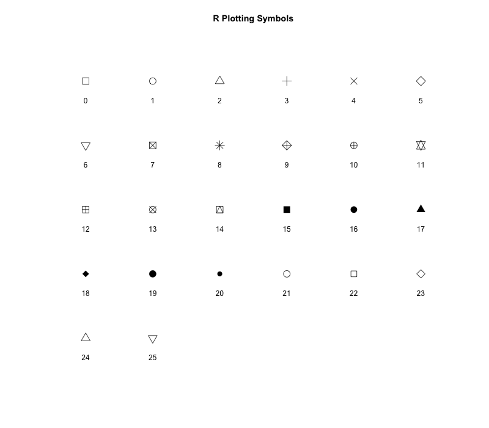
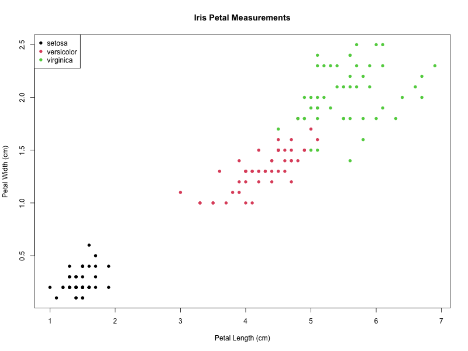

# Week 11: Graphics in R

## Problem 1: pch Symbols

For this problem, I used a for loop to make a graph showing the 26 plotting symbols in R. I used points() to draw the symbols and text() to label each one. I did not use expand.grid().

## Problem 2: Recreating a Figure

I used the iris dataset in R to make a scatterplot comparing petal length and petal width for three different iris species.

I used different colors for each species to make the graph easier to read. I also added a legend so it is clear which species each color represents.

## Source

Fisher, R. A. (1936). The Use of Multiple Measurements in Taxonomic Problems.
