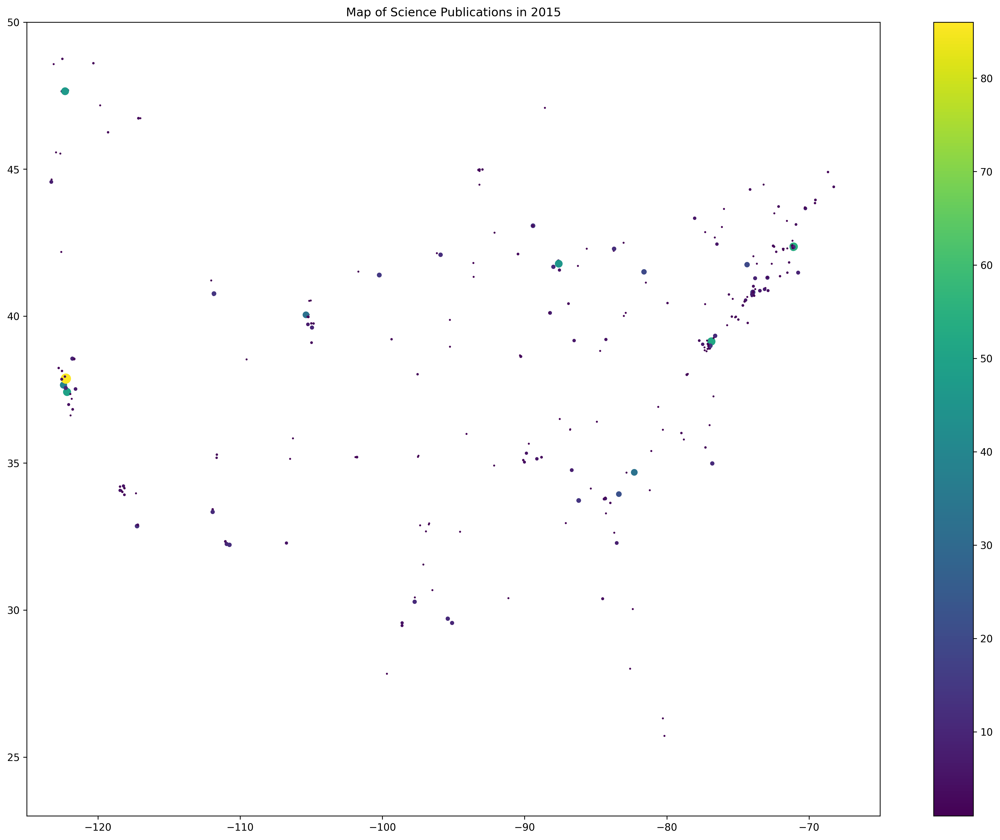

# Python IV: Map of Science

## A Map of Science

For this assignment, I used Python to look at where scientific research published in Science in 2015 came from.

### 1. Extracting ZIP Codes

I used regular expressions to find five digit ZIP codes in the PubMed file.

The program found 2,264 five digit matches in the author affiliation lines, including 494 unique ZIP codes.

### 2. Matching ZIP Codes to Locations

I used the csv module to read the coordinates file and match the ZIP codes to their latitude and longitude.

I created four lists:
- zip_code: ZIP codes
- zip_long: longitude
- zip_lat: latitude
- zip_count: number of times each ZIP code appeared

I was able to match 307 ZIP codes with coordinates.

### 3. Map of Science

I used matplotlib to create a scatter plot showing where the research came from. Larger dots represent ZIP codes that appeared more often in the data.

### 4. Conclusion

The map shows how scientific publications are distributed across different locations in the United States. Some areas have more publications than others.

